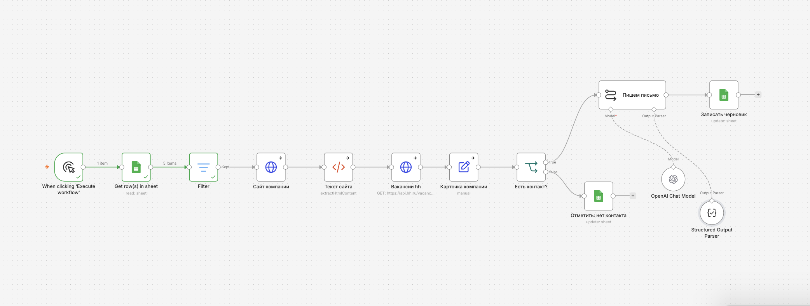

# AI outbound: первые письма HR-директорам в n8n

Схема в n8n, которая готовит персональные первые письма HR-директорам компаний с массовым наймом. Собирал её как демо для B2B-сервиса ИИ-интервью: кандидат проходит короткое видеоинтервью, работодатель получает отчёт по навыкам и оценку.

Письма никуда не отправляются. Схема пишет черновики обратно в Google-таблицу, а отправляет человек после проверки.

## Как работает

На входе Google-таблица: компания, сайт, ID работодателя на hh, email отдела кадров, открытые вакансии.

1. Читает строки из таблицы и пропускает те, где уже стоит статус. Так при повторном запуске письма не пишутся дважды.
2. Скачивает главную страницу сайта компании и вытаскивает из неё текст.
3. Пробует получить открытые вакансии через API hh.
4. Собирает всё о компании в одну карточку: название, контакт, вакансии, текст сайта (не больше 2 000 символов, чтобы не тратить лишние токены).
5. Проверяет, есть ли нормальный email. Если нет, ставит в таблице «нет контакта», и дальше эта компания не идёт.
6. Модель gpt-5-mini пишет короткую сводку о найме, тему и текст письма. Ответ приходит строго в трёх полях через Structured Output Parser, поэтому его можно сразу записать в таблицу.
7. Черновик записывается в ту же строку, статус меняется на «черновик готов».

Тест на 5 компаниях с массовым наймом: 4 черновика, одна компания ушла в «нет контакта».

## Где пришлось повозиться

- Открытый API hh отвечал 403 forbidden и из n8n, и из обычного браузера. Похоже, без авторизации его закрыли. Сделал запасной вариант: если hh не ответил, вакансии берутся из колонки в таблице. Узел hh оставил, для рабочей версии нужен официальный доступ.
- Крупные сайты блокируют ботов: один отдал 403, другой пустую страницу-заглушку. Добавил заголовок обычного браузера и продолжение при ошибке, чтобы один упавший сайт не останавливал всю схему.
- Из-за пробела перед адресом сайта в таблице запрос не уходил. Теперь адрес чистится перед запросом.
- Первая версия промпта подписывала письма выдуманными именами, давала одинаковые общие темы и писала все письма по одной формуле. Во второй версии зафиксировал подпись-заглушку, тему с должностью и названием компании и правило начинать с задачи клиента, а не с продукта.
- Один раз при правке промпта случайно стёр блок с данными о компании, и модель начала писать «<Компания>» и «<должность>». Нашёл причину по предпросмотру выражения в узле.
- Пример ответа в Structured Output Parser мог подтягиваться в письма: там были «повара и кассиры». Заменил на нейтральный.

## Пример письма (вторая версия промпта)

Название сервиса скрыто.

> **Тема:** Найм повар-пиццамейкер Додо Пицца
>
> Добрый день.
> При массовом найме поваров-пиццамейкеров и кассиров в Додо Пицце рекрутеры, скорее всего, перегружены отбором. Это тратит время на слабых кандидатов и замедляет заполнение смен.
> [Сервис] помогает рекрутерам выделять только сильных кандидатов и экономить время. Вам удобно показать сервис за 15 минут?
> [Имя], [Сервис].

Тема пока без предлога и в неправильном падеже. Это следующая правка промпта.

## Что бы сделал дальше

- официальный доступ к API hh или сервис обогащения данных вместо ручной колонки;
- проверка email перед отправкой;
- цепочка из 2–3 писем, каждое одобряет человек;
- 2–3 варианта первой фразы и сравнение по доле ответов;
- запуск по расписанию и запись в CRM вместо таблицы.

## Как запустить у себя

1. В n8n: Import from File → `workflow.json`.
2. Создать Google-таблицу с колонками `company, site, hh_id, email, status, vacancies, summary, subject, draft`. Вручную заполняются company, site, hh_id, email и vacancies, status оставить пустым.
3. В трёх узлах Google Sheets подключить свой аккаунт и выбрать таблицу.
4. В узле OpenAI Chat Model подключить ключ. В n8n Cloud хватит бесплатных кредитов.
5. В узле «Вакансии hh» вписать свой email в заголовок HH-User-Agent.
6. Нажать Execute workflow.

---

Стек: n8n Cloud, Google Sheets, OpenAI gpt-5-mini. Октябрь 2026.

Леонид Кривошеин · [портфолио](https://leonidken2.github.io/portfolio/) · Telegram [@leokrivoshein](https://t.me/leokrivoshein)
